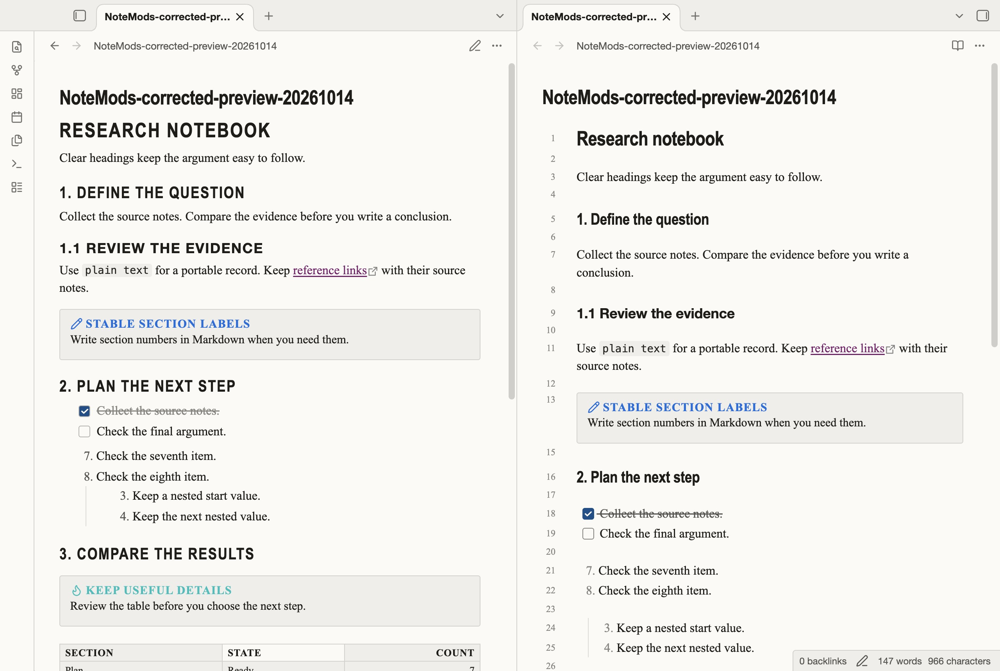
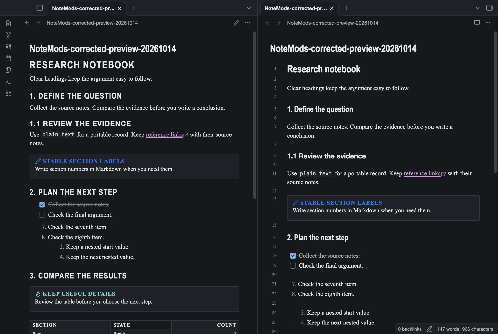
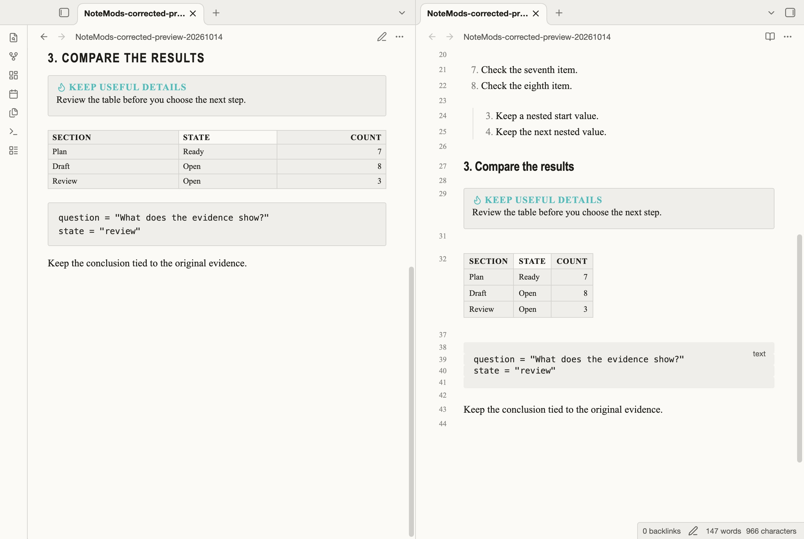
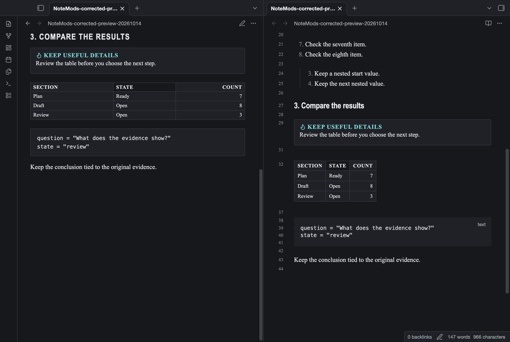

# Compendium Reference

Compact serif text and reference lists for your manuals and specifications.

This is a preview theme with light and dark modes.

## Preview status

An independent review scored source version 1.0.0 74/100 on 14 October 2026.
The NoteMods acceptance gate requires at least 95/100. This version remains on hold.
Obsidian directory approval is not claimed.

## Design

- Compact serif reference layout.
- Hanging list indents.
- Striped tables with tabular figures.

These styles change presentation. They do not add application features or plugins.

## Screenshots

These are unaltered captures from Obsidian 1.14.4 with a test note.
They show Live Preview and Reading view side by side.

### Light mode

### Dark mode

## Install the preview

1. Download `theme.css` and `manifest.json` from the `1.0.2` release.
2. Open your vault folder. Show hidden folders if necessary.
3. Create `.obsidian/themes/Compendium Reference/` inside the vault.
4. Put both files in that folder. Keep their file names unchanged.
5. Open Obsidian. Go to Settings, then Appearance.
6. Select `Compendium Reference` in the Themes list. Restart Obsidian if it is absent.

You can also copy these two files from the repository.
The manifest declares Obsidian 1.6.0 as the minimum version.
The captures verify only the desktop version stated above.

## Remove the preview

Select the default theme in Settings, then Appearance.
You can then remove the `Compendium Reference` folder from `.obsidian/themes/`.
Your note files remain in your vault.

## Known limits

- Desktop captures use Obsidian 1.14.4. Real mobile device use has not been verified.
- A narrow desktop capture does not prove mobile compatibility.
- Full keyboard navigation and assistive technology checks remain incomplete.
- Decorative separators can have low contrast. This theme has no accessibility certification.
- Font rendering can change with your operating system and installed fonts.
- Community plugins can change the layout. Their compatibility has not been verified.

## Feedback

Open an issue with your Obsidian version, operating system, selected mode, and steps to reproduce the problem.
Use a test note. Remove personal information from screenshots before you send them.

## Credits and licence

The original manifest credits Reading Factory (U1).
NoteMods maintains this preview repository. Copyright credits and MIT terms are preserved.
Metadata and licence formatting were corrected for directory review. The MIT terms are unchanged.
See [LICENSE](./LICENSE) for the MIT terms.

[View the NoteMods catalog](https://notemods.com/themes/).

## Source provenance

This is original CSS written for this project. It does not copy published theme CSS. System fonts are referenced by name only.

## Version 1.0.1

This update corrects repository metadata. The theme CSS is unchanged.
The score above is historical. These current repository files have not received a new independent review.
The 95/100 acceptance gate remains unmet.

## Version 1.0.2

Automatic heading numbers were removed because scrolling long notes could reset them to incorrect values.
Heading size, weight, and rules still show the document hierarchy.
Type section numbers in Markdown when you need stable numbered headings.
The historical score applies to source version 1.0.0. This repair has not received a new independent quality review.
The 95/100 acceptance gate remains unmet.

## Callouts and tables

